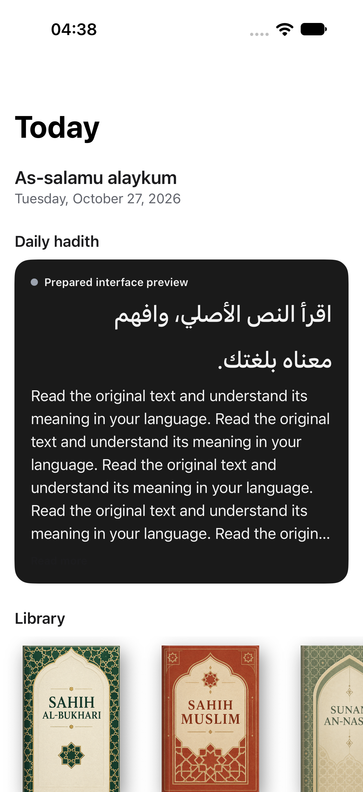
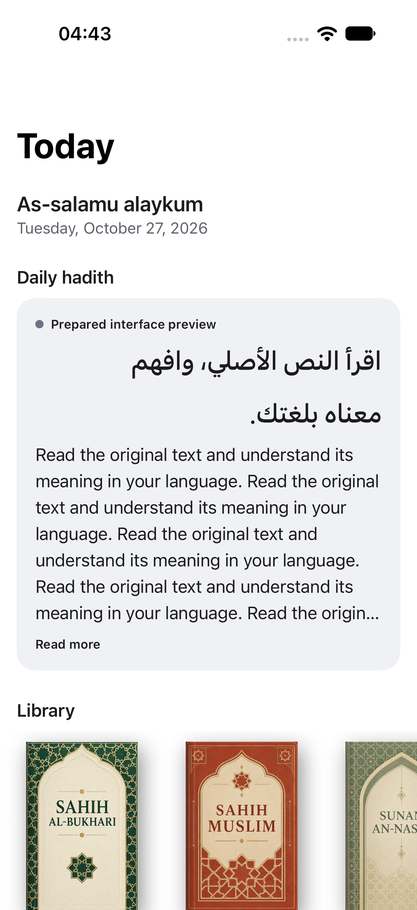
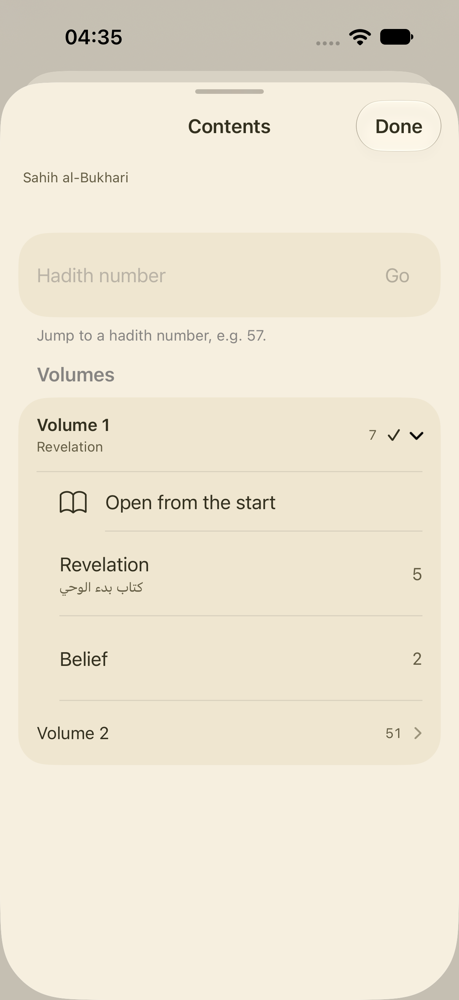
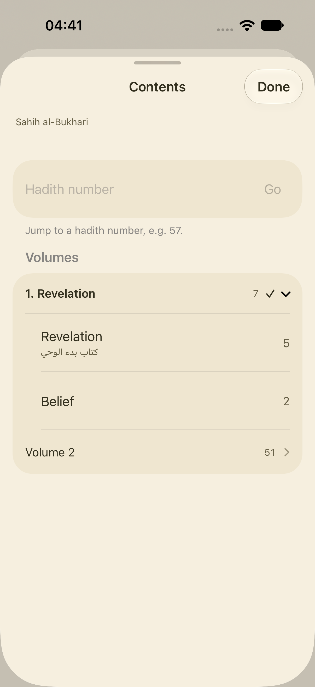
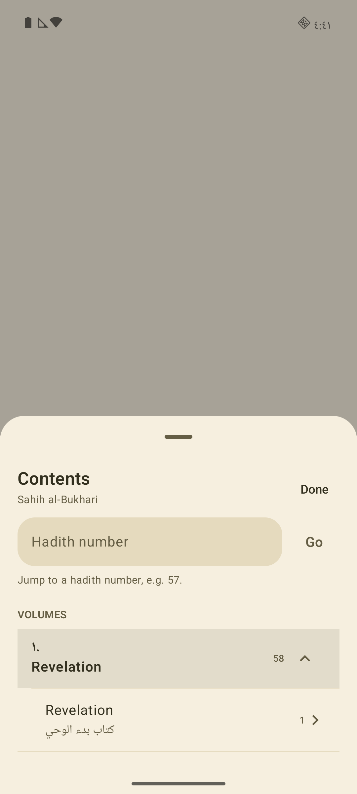

# C native refinements

October 27, 2026. B's findings are in
[`product-program/research-decisions.md`](product-program/research-decisions.md).
C remains active. Complete C before D, then return to A4–A7. Existing content,
physical-device, auth, purchase and release gates remain open.

| Requirement | Current result |
| --- | --- |
| C1 paywall | Existing monthly-equivalent prototype retained. Current visual/interaction audit remains; actual annual total remains a release requirement. |
| C2 translation reveal and states | Existing native implementation retained; current state, interruption and reduced-motion verification remains. |
| C3 focus and thin progress | Current focus baseline passes on iOS; remaining combined visual/interaction check stays open. |
| C4 separate glass elements | Current native render and glass blending threshold still need the focused pass. |
| C5 Daily appearance | Reproduced and fixed on both apps. Daily and its source presentation use app appearance, independent of the reader theme. |
| C6 Contents names and navigation | Source names now carry their actual source volume numbers. iOS removes the extra start row and opens the volume from its name. Direct volume, chapter and jump paths pass locally. |
| C7 page controls | Current native/fallback rendering and paging verification remains. |
| C8 onboarding/auth | Current asset and entry audit remains. Existing Clerk flows and external acceptance limits remain. |

## Daily appearance and Contents

The Daily regression uses the real Today view with prepared text and opposite
app/reader themes. Before the fix, a light app rendered a dark Daily card on both
platforms. iOS sampled red channel 26 against the light threshold of 180.
Both light-app/dark-reader and dark-app/light-reader cases now pass on both apps.
Typography, text visibility and the independent reader preference are preserved.
No content generation is involved.

Contents now uses the same source-name selection already used by reader headers.
It takes the number from the source title or numeric volume ID, never from the
array position. A source with volumes 1 and 3 therefore keeps 3. Missing names
retain the existing generic title; missing numbers are not invented. iOS checks
the raw generic title before localizing it, so an Arabic generic title does not
receive a second numeric prefix. Existing native List/disclosure controls and
Material rows remain. The source name itself opens the volume on both apps;
chapter selection and valid/invalid jump handling remain verified.

Independent GPT-6.1 Terra review identified the noncontiguous-number and Arabic
generic-title cases. Both were repaired and covered through actual native views.
The review used a different GPT model, respecting the owner's GPT-only rule;
it was not a cross-family review.

## Verification and rendered evidence

Eight distinct iOS checks cover this unit across the recorded runs: Daily in both
appearances, the existing sheet gallery, five Contents interaction checks and the
source-number/Arabic generic-title case. Eleven Android checks cover Daily, the
sheet gallery and nine Contents/context-action cases. The final failing cases
were rerun successfully. This is local native fixture evidence, not a claim of
continuous manual QA, full accessibility traversal or live provider/auth proof.

| Evidence | Result |
| --- | --- |
| `/tmp/hadithly-c-daily-red-ios.xcresult` and `/tmp/hadithly-c-daily-red-android.log` | Both reproduce the Daily appearance defect before the fix. |
| `/tmp/hadithly-c-daily-contents-ios.xcresult` | Daily and gallery pass; two Contents identifier lookups failed and were repaired. |
| `/tmp/hadithly-c-contents-fixed-ios.xcresult` | Chapter/jump/render checks pass; direct volume query exposed inherited duplicate identifiers. |
| `/tmp/hadithly-c-volume-tap-ios.xcresult` | The scoped query taps the actual volume name and dismissal passes. |
| `/tmp/hadithly-c-source-numbers-ios.xcresult` | Three checks pass, including source volumes 1/3 and Arabic generic-title handling. |
| `/tmp/hadithly-c-daily-contents-android.log` | Nine of ten pass. The lone failure expected an English digit on an Arabic device. |
| `/tmp/hadithly-c-contents-locale-android.log` | Locale-aware numeral assertion passes. |
| `/tmp/hadithly-c-source-numbers-android.log` | Both source-number and chapter-label checks pass. |

The iOS result collector retains per-case rerun history in
[`verification/c-native/verification.json`](verification/c-native/verification.json).
Android's final two-case XML reports are archived beside it; the broader-run
summary is retained with its command log. An initial Android run had no connected
device. The stopped AVD was launched, and a cold-boot System UI error overlay was
dismissed. Its obscured screenshot is excluded from the rendered evidence below.

| iOS before | iOS after |
| --- | --- |
|  |  |
|  |  |

| Android before | Android after |
| --- | --- |
|  |  |
| Contents baseline obscured by the system overlay is excluded. |  |

Prepared interface text is labeled in the captures. It is not offered as a real
hadith or as semantic/content-availability proof. Five incoming Xcode/catalog
files remain byte-for-byte unchanged against the C snapshot. No project
regeneration, deployment, paid provider request, billing change or publication
occurred. C4/C8 and the remaining C checks continue next.
