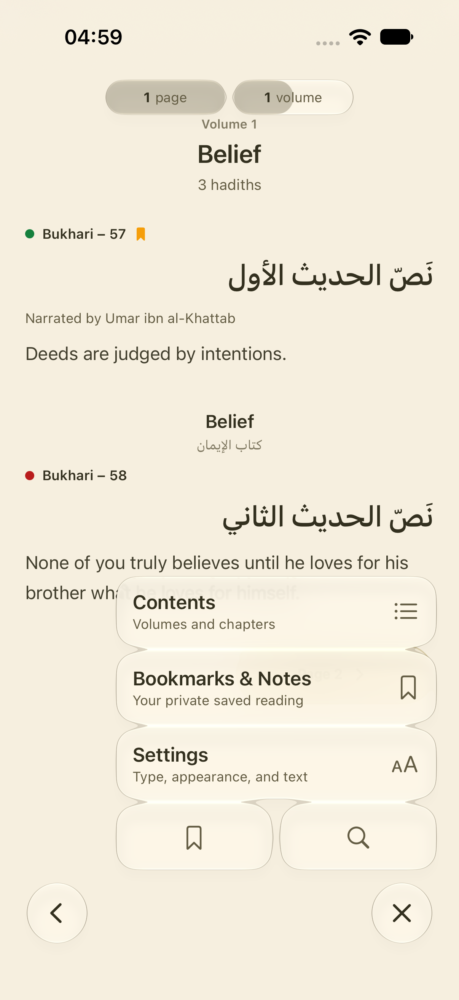
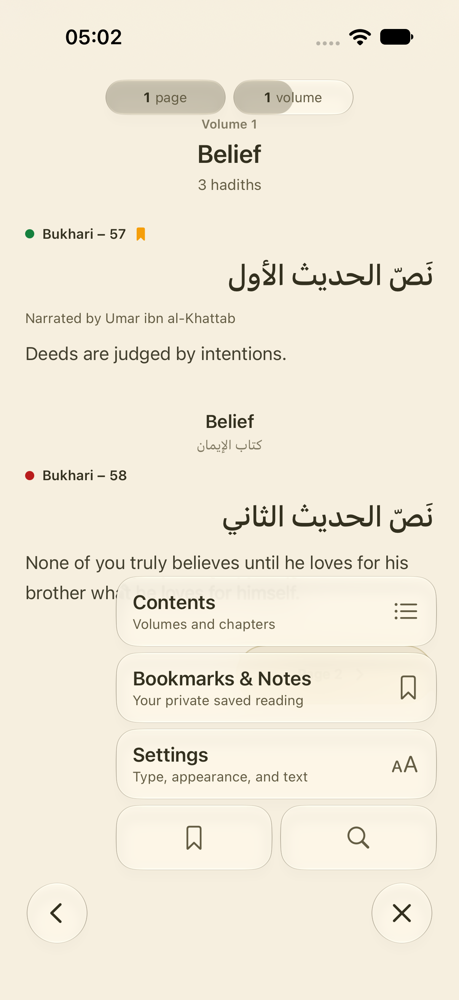
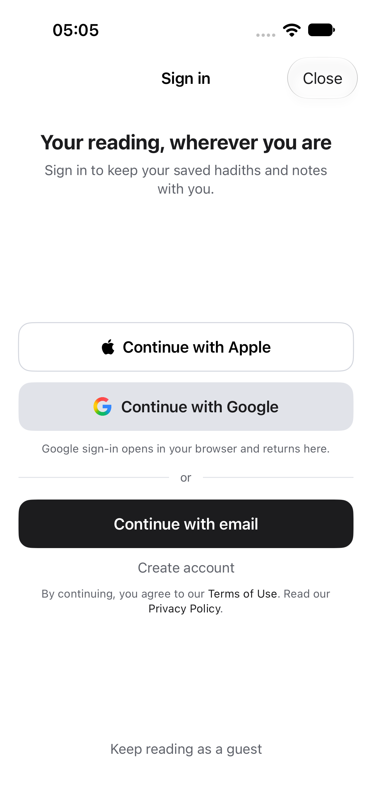
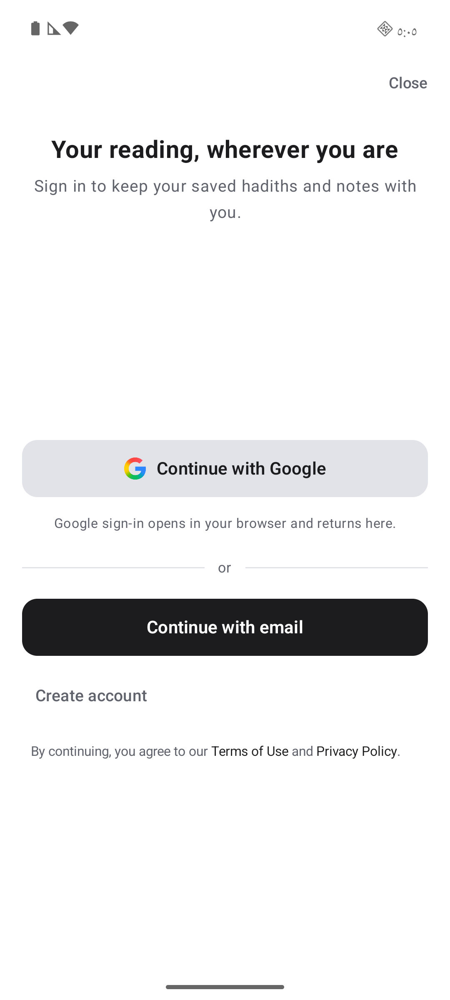
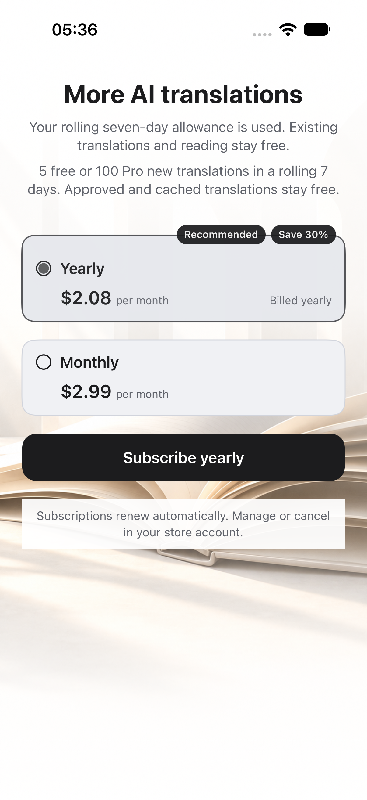
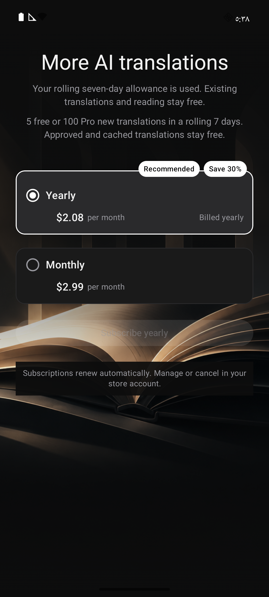

# C native refinements

October 27, 2026. B's findings are in
[`product-program/research-decisions.md`](product-program/research-decisions.md).
C remains active. Complete C before D, then return to A4–A7. Existing content,
physical-device, auth, purchase and release gates remain open.

| Requirement | Current result |
| --- | --- |
| C1 paywall | Local prototype presentation and interaction pass on both apps, including large RTL text. Actual annual total remains a release requirement. |
| C2 translation reveal and states | Existing native implementation retained; current state, interruption and reduced-motion verification remains. |
| C3 focus and thin progress | Current focus baseline passes on iOS; remaining combined visual/interaction check stays open. |
| C4 separate glass elements | iOS fusion reproduced and repaired; sampled rendered gaps and Android Material parity pass. |
| C5 Daily appearance | Reproduced and fixed on both apps. Daily and its source presentation use app appearance, independent of the reader theme. |
| C6 Contents names and navigation | Source names now carry their actual source volume numbers. iOS removes the extra start row and opens the volume from its name. Direct volume, chapter and jump paths pass locally. |
| C7 page controls | Current native/fallback rendering and paging verification remains. |
| C8 onboarding/auth | Official Google artwork and a contextual browser hint are implemented. Entry, cancellation, recovery and keyboard checks pass locally. External OAuth/account acceptance limits remain. |

## Daily appearance and Contents

The Daily regression uses the real Today view with prepared text and opposite
app/reader themes. Before the fix, a light app rendered a dark Daily card on both
platforms. iOS sampled red channel 26 against the light threshold of 180.
Both light-app/dark-reader and dark-app/light-reader cases now pass on both apps.
Typography, text visibility and the independent reader preference are preserved.
No content generation is involved.

Contents now uses the same source-name selection already used by reader headers.
It takes the number from the source title or numeric volume ID, never from the
array position. A source with volumes 1 and 3 therefore keeps 3. Missing names
retain the existing generic title; missing numbers are not invented. iOS checks
the raw generic title before localizing it, so an Arabic generic title does not
receive a second numeric prefix. Existing native List/disclosure controls and
Material rows remain. The source name itself opens the volume on both apps;
chapter selection and valid/invalid jump handling remain verified.

Independent GPT-6.1 Terra review identified the noncontiguous-number and Arabic
generic-title cases. Both were repaired and covered through actual native views.
The review used a different GPT model, respecting the owner's GPT-only rule;
it was not a cross-family review.

## Verification and rendered evidence

Eight distinct iOS checks cover this unit across the recorded runs: Daily in both
appearances, the existing sheet gallery, five Contents interaction checks and the
source-number/Arabic generic-title case. Eleven Android checks cover Daily, the
sheet gallery and nine Contents/context-action cases. The final failing cases
were rerun successfully. This is local native fixture evidence, not a claim of
continuous manual QA, full accessibility traversal or live provider/auth proof.

| Evidence | Result |
| --- | --- |
| `/tmp/hadithly-c-daily-red-ios.xcresult` and `/tmp/hadithly-c-daily-red-android.log` | Both reproduce the Daily appearance defect before the fix. |
| `/tmp/hadithly-c-daily-contents-ios.xcresult` | Daily and gallery pass; two Contents identifier lookups failed and were repaired. |
| `/tmp/hadithly-c-contents-fixed-ios.xcresult` | Chapter/jump/render checks pass; direct volume query exposed inherited duplicate identifiers. |
| `/tmp/hadithly-c-volume-tap-ios.xcresult` | The scoped query taps the actual volume name and dismissal passes. |
| `/tmp/hadithly-c-source-numbers-ios.xcresult` | Three checks pass, including source volumes 1/3 and Arabic generic-title handling. |
| `/tmp/hadithly-c-daily-contents-android.log` | Nine of ten pass. The lone failure expected an English digit on an Arabic device. |
| `/tmp/hadithly-c-contents-locale-android.log` | Locale-aware numeral assertion passes. |
| `/tmp/hadithly-c-source-numbers-android.log` | Both source-number and chapter-label checks pass. |

The iOS result collector retains per-case rerun history in
[`verification/c-native/verification.json`](verification/c-native/verification.json).
Android's final two-case XML reports are archived beside it; the broader-run
summary is retained with its command log. An initial Android run had no connected
device. The stopped AVD was launched, and a cold-boot System UI error overlay was
dismissed. Its obscured screenshot is excluded from the rendered evidence below.

| iOS before | iOS after |
| --- | --- |
|  |  |
|  |  |

| Android before | Android after |
| --- | --- |
|  |  |
| Contents baseline obscured by the system overlay is excluded. |  |

Prepared interface text is labeled in the captures. It is not offered as a real
hadith or as semantic/content-availability proof. At this checkpoint, five incoming
Xcode/catalog files remained byte-for-byte unchanged against the C snapshot. No project
regeneration, deployment, paid provider request, billing change or publication
occurred.

## Separate glass controls and coherent auth

C4's production-reader fixture reproduced visible fusion between menu cards. The
container's 12-point blending distance exceeded the six-point visual gaps. Setting
the blending distance to zero preserves the existing sizes, gaps and native glass
while keeping each control separate. The rendered gap test failed with an average
RGB-channel difference of 25 from the underlying reader, then passed at 2 and 3.
The first diagnostic attempt merely started focused and did not find the menu;
it is not counted as reproduction of the glass defect. Android retains native
Material surfaces, with passing order/size checks and a rendered parity capture.

C8 replaces the hand-drawn Google mark with the unmodified official
[Google G asset](https://developers.google.com/static/identity/images/g-logo.png),
linked from [Google's branding guidance](https://developers.google.com/identity/branding-guidelines).
Both native resource files have SHA-256
`d1ce9c2af0b10a7333abc99bc706f9a6a199e5b65bf3e3009624f076b8638e6a`.
They preserve its color and aspect ratio. The nearby hint explains the existing
browser handoff. Apple and email flows, Clerk calls, identity resolution,
cancellation/recovery handling and billing are unchanged.

The hint uses `c-native-copy.json` and the existing scoped copy generator. All 15
locale entries are present; non-English copy remains draft/needs_review. The full
A4 sweep and native-speaker approval are still open. Removing exactly this new
catalog entry restores every byte of the incoming catalog snapshot. Only this
entry is staged for C8; the four incoming project/scheme files remain untouched.

Four iOS checks pass in `/tmp/hadithly-c-glass-auth-ios.xcresult`, covering the
glass gap, auth previews/keyboard, first-install route and Settings cancellation.
The final hint render also passes in `/tmp/hadithly-c-browser-hint-ios.xcresult`.
Android's three auth/entry checks pass in `/tmp/hadithly-c-auth-android.log`, its
final hint/keyboard check in `/tmp/hadithly-c-browser-hint-android.log`, and both
menu parity checks in `/tmp/hadithly-c-menu-android.log`. These are local native
checks. They do not prove an external OAuth round trip or an account/store receipt.
Independent GPT-6.1 Terra review found no actionable regression in this unit.

| Fused menu before | Separate native controls after |
| --- | --- |
|  |  |

| iOS Google handoff | Android Google handoff |
| --- | --- |
|  |  |

No new hosted Motion Agent credit was used. The prior authorized run and native
motion references remain recorded in `NATIVE_READER_REFINEMENT.md`. Continue C1
and the remaining C2/C3/C7 verification before D.

## Paywall prototype

C1 reuses the native entry artwork behind a simpler heading and two native plan
choices. The annual recommendation and savings labels overlap the option's upper
edge, wrapping naturally when larger text needs more space. Accessibility sizes
stack the price and billing labels. The renewal text has an opaque-enough reader
background to remain readable over the artwork. Selection, price calculation,
purchase, restore and entitlement logic are unchanged.

Independent GPT-family review caught the missing explanation for the rejected
request. The shared heading now retains the existing seven-day exhaustion message
and free-reading assurance. Visual review then found Bengali text incorrectly
copied into seven Android locales. `scripts/sync-paywall-quota-copy.py` reuses this
single message's existing iOS drafts across all fifteen Android locales, with a
rerunnable parity check. These remain drafts awaiting native review.

The two iOS checks in `/tmp/hadithly-c-paywall-reason-ios.xcresult` pass. They
exercise light/dark selection and full price visibility at large Arabic Dynamic
Type, including the Arabic savings label. Android's final copy rerun is recorded
in `verification/c-native/paywall/verification.json`. Earlier layout checks also
passed, but the earlier Android Arabic capture revealed the copy defect and is
superseded. A separate real Android sheet check with an empty purchase API key
passed the existing finite allowance, account explanation, restore guard and close
journey. No store request or receipt is proved by these fixtures.

| iOS prototype | Android prototype |
| --- | --- |
|  |  |

Prices are prepared samples. The owner-approved monthly-equivalent-only prototype
is retained. The missing actual annual total is an explicit store-readiness gate;
this unit does not approve the paywall for release. Large RTL captures demonstrate
scrollable access to both complete prices, not native-copy approval.
