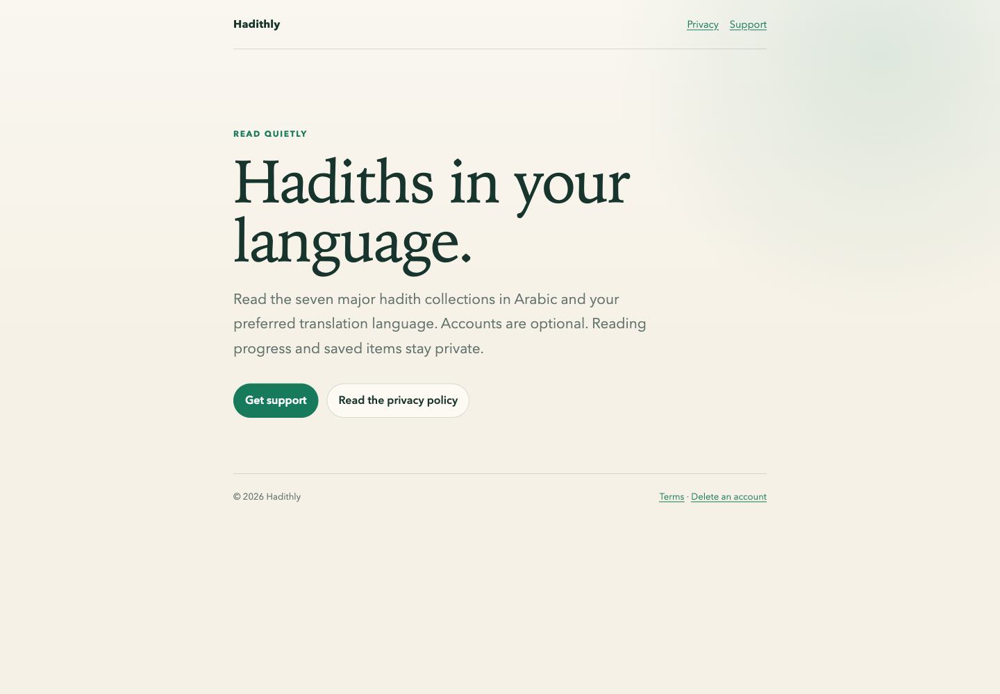
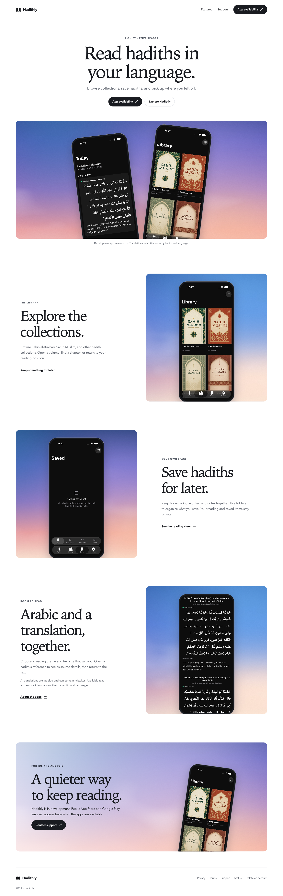
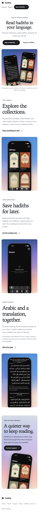
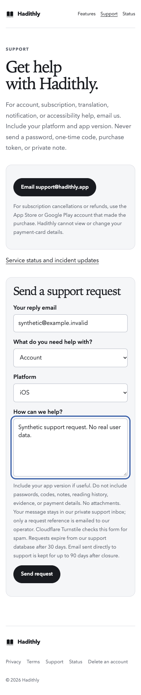

# D website redesign

October 27, 2026. Local implementation and preview verification are complete.
Nothing has been published. Continue A4–A7, preserving the existing content,
account, store, physical-device and release gates.

The static site now follows the supplied package's white canvas, serif headings,
quiet navigation, sky artwork and native app presentation. The home page explains
collections, Saved and reading. Privacy, terms, support, account deletion, status
and the existing invalid-hadith-link page share the same typography and navigation.
There is no new web reader. LA4 remains deferred.

## Assets and claims

The package is `/Users/alim/Downloads/hadithly-redesign-package.zip`. Its website
logos and two sky images are used only in `site/assets`. JPEG compression keeps
the complete asset directory near 1.6 MB. The package's concept app screens and
illustrative Arabic transcriptions are not used.

Product images come from an actual native development-app journey through
onboarding, cancelled sign-in, guest entry, Today, Saved, Library and the reader.
The final reader image shows Sahih al-Bukhari 13 with Arabic and English visible
together. Saved shows an empty personal library, without fabricated user activity.
Raw captures are archived locally at
`/Users/alim/Documents/Codex/2026-10-27/hadithly-d-website/native-captures`.
Asset hashes and the package hash are in `verification/d-website/assets.json`.

The home page says the apps are in development and provides no invented store
URLs. Language availability varies by hadith. AI text is labeled and can contain
mistakes. There are no accuracy, retention, user-count, native-language approval
or release-readiness claims. Public screenshots and content/asset rights remain
part of the existing publication and release review; local capture is not a grant
of redistribution rights.

## Verification

- `scripts/verify-marketing-preview.js` ran in the named local Chrome session.
  All seven routes pass at 1440, 768, 390 and 320 pixels. It checks horizontal
  overflow, visible headings, landmarks, image alternatives, form labels, anchors,
  image loading, keyboard skip navigation, feature/availability navigation,
  checkbox interaction, reduced motion and 200% text size. No page errors occurred.
- Rendered inspection covered all seven pages. It caught a long support email
  button overflowing at 200% text size and an oversized checkbox inherited from
  generic text-input styles. Both are repaired. Grid children also now shrink
  correctly at enlarged text sizes. A light scrim keeps the availability text
  readable over the supplied sky artwork.
- `scripts/test-la3-site.py --base http://127.0.0.1:8787 --output
  output/playwright/hadithly-d/forms` passes the existing disabled-form fallback,
  submission serialization, success, limits, preserved failed text, status staleness,
  escaped incident text and outage checks. All external services are test doubles.
  No support request was sent.
- The six supporting pages' main content is byte-for-byte unchanged, apart from
  attributes on the opening `main` tag. Eight behavior/configuration files,
  including support, status, canonical routing and diagnostics, are unchanged.
  `verification/d-website/source-preservation.json` records hashes against `a1226ff`.
- `/tmp/hadithly-d-product-return-ios.xcresult` passes the actual native journey
  and Contents keyboard submission to Bukhari 13. Its capture is verified by a
  visible English translation assertion. The first live Go-button tap attempt did
  not navigate; keyboard submission passed. The failed attempt remains in the
  native result history and is an A5 follow-up, not a repaired Go-button claim.
- `scripts/check-launch-site.sh` still stops at the missing Play App Signing
  certificate/Android asset links. This pre-existing release gate remains open.
  Local Chrome checks do not prove production Vercel routing, current provider
  operation, external OAuth, delivery, rights or store availability.

Preview rerun:

```sh
python3 -m http.server 8787 --bind 127.0.0.1 --directory site
# In another terminal, with the Playwright skill CLI available:
playwright-cli -s=hadithly-d open http://127.0.0.1:8787 --browser=chrome --headed
playwright-cli -s=hadithly-d run-code --filename scripts/verify-marketing-preview.js
```

The verifier blocks external network services. The support regression uses its
own intercepted fixtures. No deployment, paid generation, new tracking, cloud or
credential change, external message, or public publication occurred.

| Before | Local redesign |
| --- | --- |
|  |  |

| Mobile home | Support form with test doubles |
| --- | --- |
|  |  |
