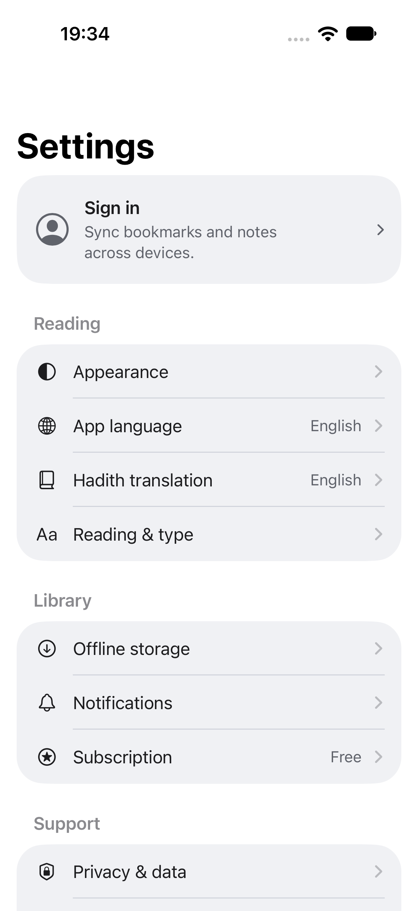
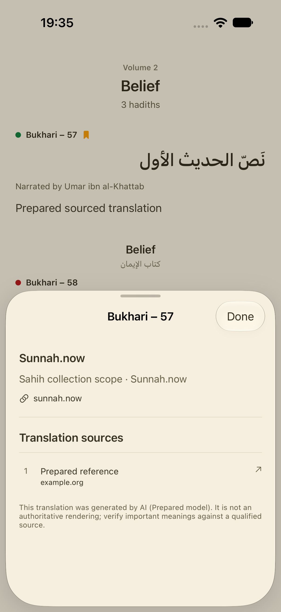

# Reader interaction follow-up

Owner-authorized scope, 2026-10-15, following native polish commit `1bc0892`.
This is product work; L1 and existing release/device gates remain open.

## Behavior

- The hadith reference/grade-dot button opens one sheet with the source claim,
  source link and the displayed translation's citations/provenance. The separate
  AI/community badge is removed from reading text. No extra sparkle is added to
  the header. Attribution remains explicit inside the source details.
- On the first reader opening, a small dismissible hint explains touch-and-hold
  actions. It expires after seven seconds, closes when the long-press menu is used, and is
  remembered once per installation. It never blocks reading or opens a modal.
- Settings uses a compact sign-in row with a brief sync explanation. The root
  Settings heading is checked as rendered text, not only an accessibility label.
- Automatic translation defaults on for untranslated visible hadiths. A native
  switch in both reader and global Reading & type settings enables manual mode.
  The choice is device-local and persists between launches.
- Automatic requests wait for 450 ms of visibility on the active page. Hidden
  translations, signed-out users, available provider/cached text and existing
  loading/loaded/failed states do not create new automatic requests. A per-locale
  ledger prevents repeated attempts while scrolling away and back. Session changes
  restart the visibility scheduling. Explicit retry remains available.
- Generation still uses the existing Convex action, identity, device proof,
  reservation, rate and translation-allowance checks. Automatic quota failure
  does not open a paywall. No backend/schema/provider or store change is included.

## Paging diagnosis

The [Transitions.dev page pattern](https://transitions.dev/skill.html) informed
stable adjacent surfaces and a short native settle. Reading pages retain full
finger-following travel; CSS, text blur and a web pager are not shipped in native.
No additional hosted fix was spent for this follow-up.

Two native regressions were reproduced before the repair:

| Platform | Failing check | Repair |
| --- | --- | --- |
| iOS | Incoming preview Arabic at 110.33 pt, settled Arabic at 287.67 pt: a 177.33 pt handoff jump | Use the same `ReaderPageView` for every kept volume/page slot, including headers, padding, chapters and navigation; keep model/scroll capture owned by the active page |
| Android | Appending cached pages during an active drag moved `currentPage` from 1 back to 0 | Guard model-to-pager synchronization while the native pager is dragging from that model page |

The iOS settle uses the 250 ms motion role and a nonanimated transaction for the
page-index/offset handoff. Further drags are locked during settling. Cancel-back
respects Reduce Motion. Physical slot availability is used for RTL clamping.
Android keeps native `HorizontalPager` gesture/velocity behavior. New cache pages
do not take over its in-flight scroll.

Red evidence: `/tmp/hadithly-reader-handoff-baseline.xcresult` and
`/tmp/hadithly-reader-pager-android-red.log`. Green focused evidence:
`/tmp/hadithly-reader-handoff-green.xcresult` and
`/tmp/hadithly-reader-pager-android-green.log`.

## Verification

The fixtures mount the actual shared page renderer and, for interaction tests,
the production `ReaderView` with prepared pages. They do not make live paid
translation requests. Automatic dispatch is exercised through a debug test
observer; request deduplication and persistence also have unit/instrumented tests.

- iOS broader pass: 30 unit tests and nine UI flows passed in
  `/tmp/hadithly-reader-followup-native.xcresult`, including source consolidation,
  actual forward/back/cancel swipes, first hint/dismiss/reopen, settings semantics,
  three themes, large RTL content, real Reduce Motion and prepared result reveal.
- Android final reviewed pass: 203 unit tests and 47 UI checks passed in
  `/tmp/hadithly-reader-followup-android-reviewed.log`. It covers LTR/RTL, fast,
  canceled and vertical gestures, cache append mid-drag, combined source details,
  existing generation/quota/community states, settings and preference persistence.
- Final iOS reviewed bundle: four unit tests and six UI flows pass in
  `/tmp/hadithly-reader-followup-reviewed.xcresult`, including title pixels,
  latest account-change dwell, LTR/RTL production swipes, handoff continuity,
  combined source details and the existing community-source fixture. An old
  citation-height assertion observed 43.99999999999994 pt for a 44 pt control;
  its comparison now permits 0.01 pt floating-point tolerance.
- Android hint follow-up: 203 unit tests and nine UI checks pass in
  `/tmp/hadithly-reader-hint-android-final.log`, including the early close/reopen
  lifecycle case. There are 48 unique UI checks across the two runs.
- Copy: six additional keys (16 total in the scoped corpus) across 15 locales.
  `scripts/generate-ui-polish-copy.py --check` passes; non-English copy is still
  explicitly draft/needs_review, not native-speaker approval.

Runtime screenshots and [extracted result summaries](verification/reader-followup/results.json)
are in `verification/reader-followup/`.

| Settings title and sign-in row | Merged reader sources |
| --- | --- |
|  |  |

Other previews: [reader](verification/reader-followup/reader-light.png),
[RTL Paper reader](verification/reader-followup/reader-rtl-paper.png), and
[automatic/manual setting](verification/reader-followup/reader-settings-paper.png).

 The first accessibility-only title assertion
passed while the title was visually blank; that evidence was insufficient and
was replaced with a pixel assertion. The UIKit diagnostic found a black, fully
opaque large-title label in the List under an opaque navigation-bar background.
Removing forced background visibility restored the title; the pixel regression
changed from 0.0 visible ink to a pass. The temporary diagnostic code was removed.

An Android close/reopen check also verifies that disposing the reader before the
seven-second hint timeout clears its transient visibility. This prevents a hint
from reappearing after it has already been marked seen.

## Remaining gates

Physical-device frame pacing, the full VoiceOver/TalkBack traversal and live
signed-in generation/entitlement/account-switch acceptance remain open. This pass
proves presentation, dispatch policy and native interaction with prepared data;
it does not claim new live provider/billing verification. All earlier gates in
`OPEN_GATES.md` remain open. No push or deployment is part of this session.
