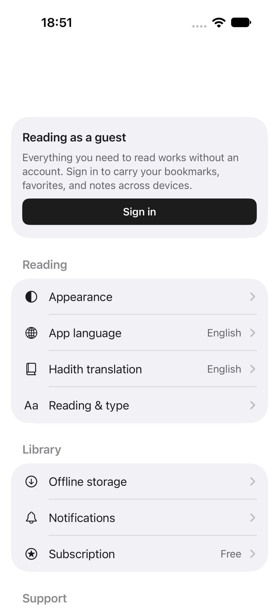
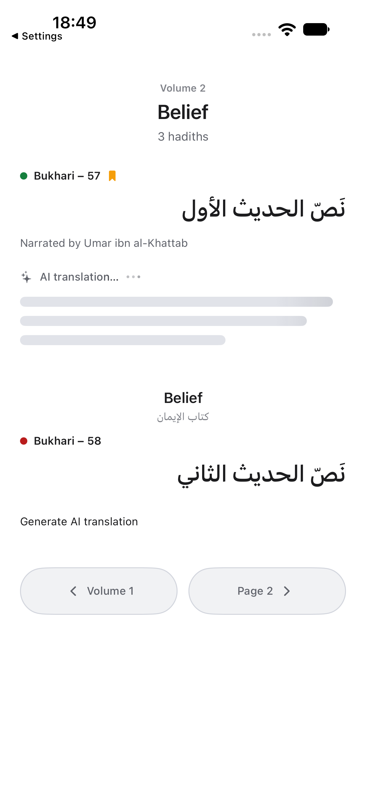
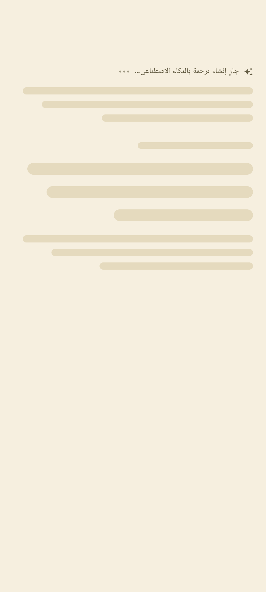

# Native interface polish verification

2026-10-15. Owner-authorized follow-up to reader settings and the Light-theme,
loading and motion request. This does not start L1 or close release gates.

## Result and scope

Both native apps use separate Light canvas, surface and elevated colors. The iOS
List row background was attached at the wrong level, which left real settings
rows white even when the palette defined a gray surface. The rendered regression
first failed with a zero row/canvas difference, then passed after correcting the
row background owner. Paper captions also needed stronger contrast.

Initial Reader, Today, Library progress, Saved and subscription content now show
native skeletons. Existing data stays visible while refreshing. Saved and
subscription failures have explicit retry states instead of an endless loader
or a false empty/Free state. Account, billing, provider and quota rules are unchanged.

AI waiting uses a persistent label, shimmer, staggered dots and text placeholders.
The result appears as a complete translation through the existing state machine;
there are no invented stages or streamed tokens. Onboarding uses its prepared
example, a finite entry shimmer and an immediately usable reveal action. No
provider request or artificial waiting was added to onboarding.

Collection numbers share the first text baseline with their names in Library
and the Today shelf. Local reading progress without an authoritative total no
longer displays a zero/null denominator in the touched Library/Android shelf slots.

## Motion gap review

The [Transitions.dev skill](https://transitions.dev/skill.html) was used to inspect
missing interaction feedback as well as existing durations. The web scanner
cannot discover native interaction gaps. Its score is not mobile acceptance.

| Native interaction | Gap addressed | Behavior |
| --- | --- | --- |
| Initial content | Bare spinner or false empty state | Content-shaped skeleton while the real request is pending |
| AI translation | Spinner gave little continuity | Labeled waiting, independent shimmer/pulse loops, full-result reveal |
| Onboarding example | Abrupt reveal and step replacement | Prepared placeholder, reveal and short directional step transition |
| Today card | Abrupt data/expanded-height changes | Content fade and 250 ms expansion |
| Library | Abrupt layout swap and number on a separate line | Short layout fade; shared title baseline |
| Saved | Abrupt filtering, insertion and preview disclosure | Native list transitions and 250 ms preview expansion |
| Press feedback | Plain custom collection/onboarding actions | Small native press feedback where applicable; standard controls retain platform behavior |

The final review caught the missing Android Today expansion and it was corrected.
Repeating motion stops when the app is inactive. iOS Reduce Motion and Android
animator scale zero keep the waiting label and static placeholders. Native system
navigation, standard selection controls and existing reader chrome remain the
owners of their transitions. Frequent page reading does not gain decorative motion.

The hosted Motion Agent was actually run once, using the supplied license in
process environment only. It reviewed a two-file UI-only study and reported
**1/10 hosted fixes used this month**. Six duration findings were fixed; its
prototype score went from 94 to 100. Review found a conflicting generated token
alias, so reveal and repeating-loop tokens were separated before adaptation.
See [hosted review](TRANSITIONS_AGENT_REVIEW.md) and the committed
[motion study](motion-study/index.html). No React/CSS runtime is shipped in mobile.

## Native evidence

The debug-only fixture mounts the actual native feature views and shared
components, supplies prepared data and skips remote sync/widget writes. The
translation UI test drives the real pending/loaded presentation states with a
prepared result; it does not make a paid live-generation request. This proves UI
behavior, not a new provider, billing or authenticated production acceptance.

| Check | Evidence and outcome |
| --- | --- |
| Light settings row/canvas difference | Pixel assertions on real SwiftUI List and Compose reader controls pass |
| Palette parity and contrast | `scripts/check-native-palette.py` passes; minimum secondary text contrast is Light 4.68:1, Paper 4.73:1, Dark 4.99:1 across the three surfaces |
| iOS native states | 35 unit tests and six UI flows pass in `/tmp/hadithly-polish-verified.xcresult` |
| iOS theme matrix | Today loading, Library ready, Saved loading and Reader loading captured in Light, Dark and Paper |
| iOS motion and completion | Real Settings Reduce Motion toggled and restored; image comparisons show active AI waiting changes and reduced waiting stays identical; result replaces waiting |
| iOS navigation/error | Actual Today refresh, expansion, Saved/Today error states, prepared reveal, full onboarding forward/back/skip/guest completion pass |
| iOS text/layout | Large text and RTL Library grid/list plus reduced-motion onboarding reveal pass |
| Android native states | 202 unit tests and 13 focused instrumented checks pass on the final reviewed implementation, including Today expansion (`/tmp/hadithly-polish-android-reviewed.log`) |
| Android text/layout/motion | Three-theme waiting/skeleton renders, 2x RTL baseline layout, real animator scale zero and active-motion pixel comparisons pass |
| Scoped copy | `scripts/generate-ui-polish-copy.py --check` passes: ten keys in 15 locales; non-English strings remain explicitly draft/needs_review |

Final iOS follow-up: large RTL Library/onboarding passed on the final source. The
old Saved shortcut test initially failed before mounting its fixture because its
helper omitted the automation environment flag. The guard was retained and the
helper corrected; the complete Saved shortcut expansion, open, note and edit
flow then passed in `/tmp/hadithly-polish-saved-final.xcresult`.

Extracted native result counts, including that failed follow-up and successful
rerun, are retained in [results.json](native-polish/results.json).

Selected original native screenshots are committed in
[native-polish/](native-polish/). They are fixture evidence, not store artwork.

| Light Settings | AI waiting | Paper on Android |
| --- | --- | --- |
|  |  |  |

More examples: [Today loading](native-polish/ios-today-loading.png),
[onboarding revealed](native-polish/ios-onboarding.png),
[Paper Library and collection title](native-polish/ios-library-paper.png),
[Android settings](native-polish/android-light-settings.png),
[Android Today prepared content](native-polish/android-today-ready.png).

## Repeat checks

From the repository root:

```sh
python3 scripts/check-native-palette.py
python3 scripts/generate-ui-polish-copy.py --check
cd ios && xcodegen generate
```

Run `xcodebuild test` using scheme `LA2Verification`, a local iPhone simulator,
and these selectors (reuse the configured package checkout if required locally):

```text
HadithlyTests/NativePresentationTests
HadithlyTests/ReaderPagingTests
HadithlyTests/ReaderPreferencesTests
HadithlyTests/ReaderR4Tests
HadithlyTests/SavedSafetyPreferencesTests
HadithlyTests/SettingsS1Tests
HadithlyUITests/VisualPolishUITests
HadithlyUITests/ReaderR6Round3UITests/testSavedShortcutTabsRowsAndEdit
```

```sh
JAVA_HOME=/Users/alim/Library/Java/JavaVirtualMachines/openjdk-21.0.1/Contents/Home \
android/gradlew -p android assembleDebug testDebugUnitTest connectedDebugAndroidTest \
-Pandroid.testInstrumentationRunnerArguments.class=com.hadithly.app.core.theme.NativePolishTest,com.hadithly.app.features.settings.ReaderPreferenceContentTest,com.hadithly.app.features.settings.SettingsP5SemanticsTest,com.hadithly.app.features.saved.SavedItemRowTest
```

## Remaining gates

Physical iPhone/Android motion, VoiceOver/TalkBack traversal, live authenticated
refresh/entitlement behavior and the existing full device matrix remain open.
New locale copy is generated draft text pending native-speaker review; this pass
is not localized-release approval. Existing offline, widgets, sync, store,
operational and release gates in `../OPEN_GATES.md` remain open. L1 has not started.
